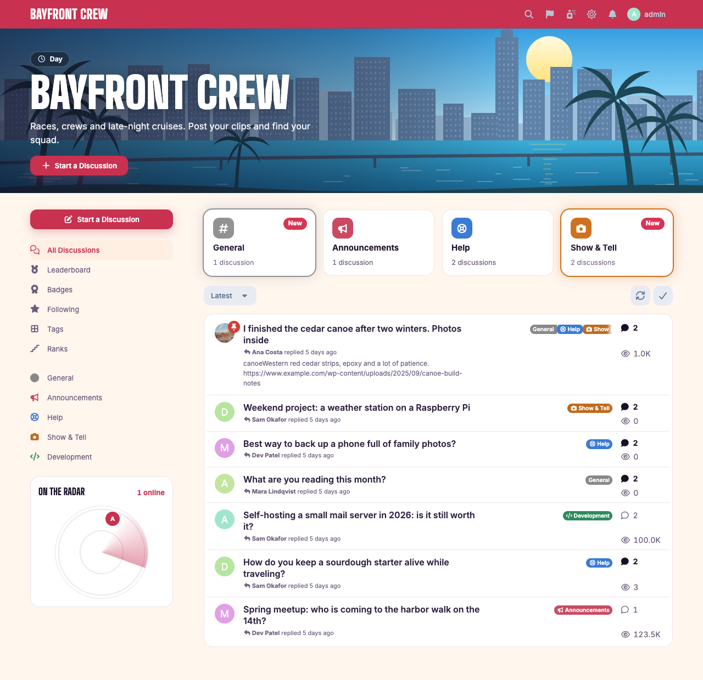
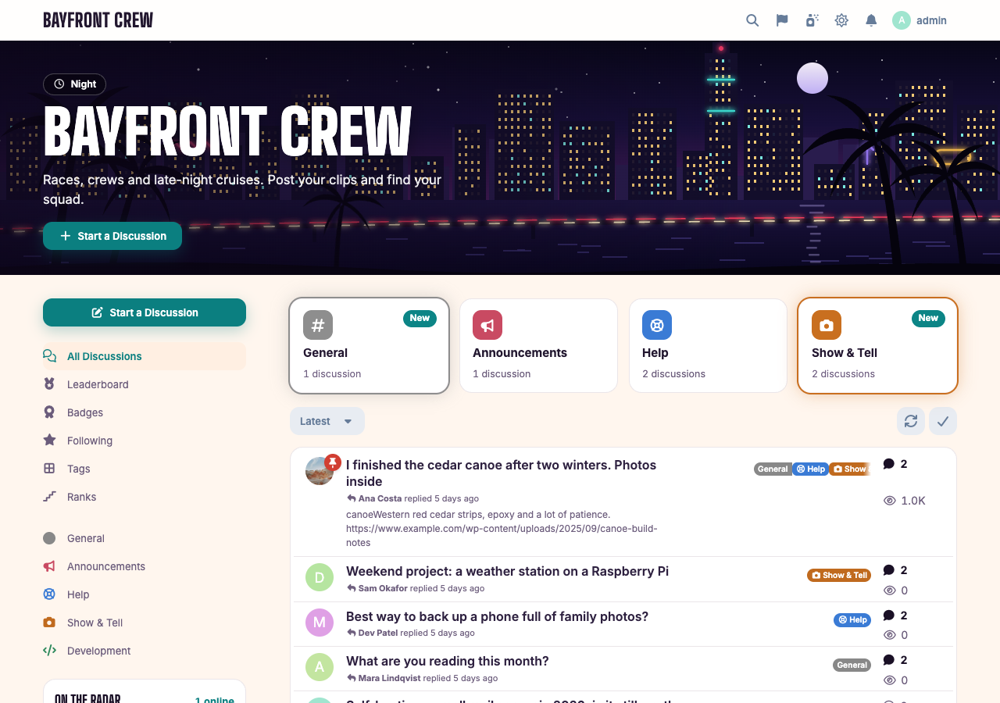
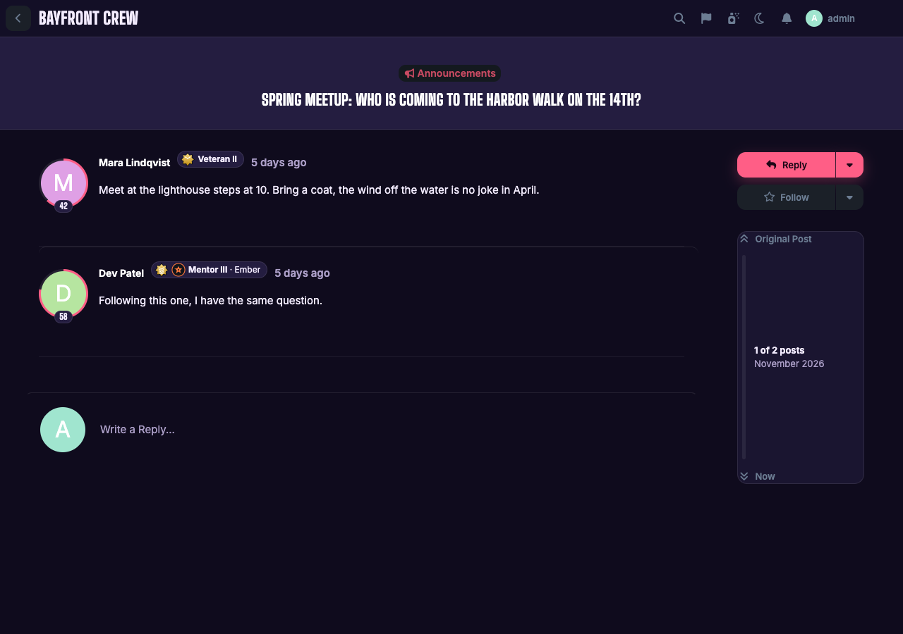
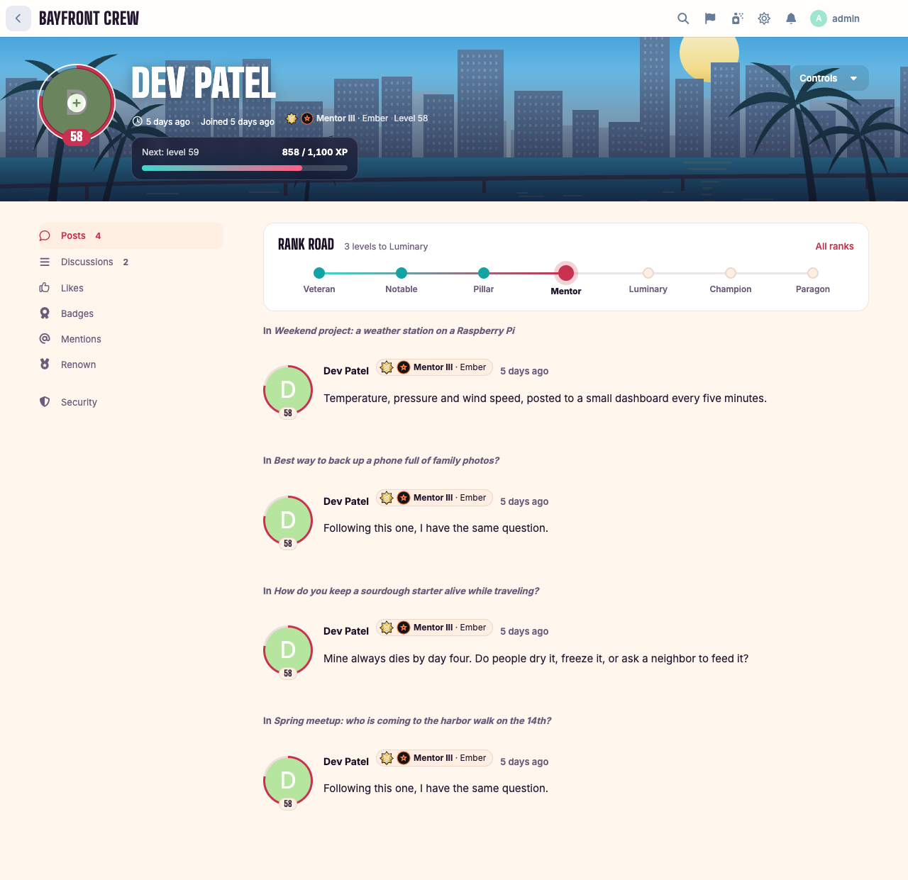
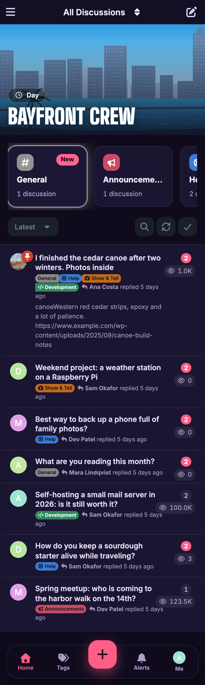
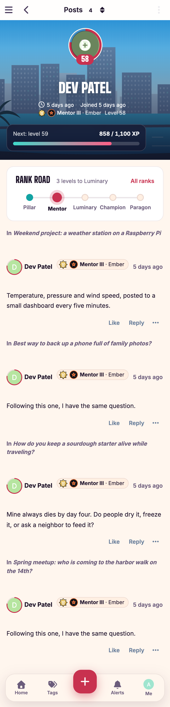
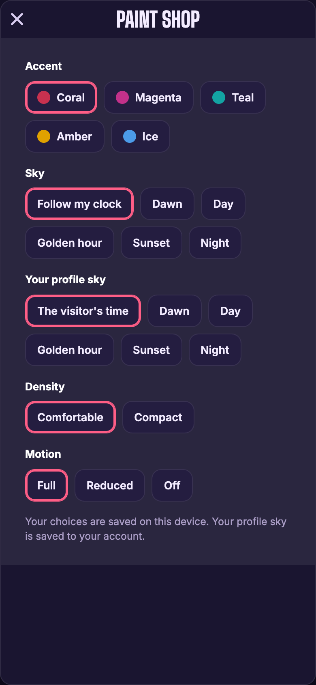

# Duskline

A gaming theme for **Flarum 2**. An illustrated neon coastal skyline sits at the top of the discussion list, and its sky follows each visitor's own clock: dawn, day, golden hour, sunset and night, with the windows lighting up after dark.



## What it does

- **A sky that keeps your visitors' time.** One drawing in five lights, picked from each visitor's own clock before the page paints, and checked again every few minutes. Admins can fix one time of day instead, or use their own picture or a short muted video.
- **Player cards.** With [Renown](https://github.com/ernestdefoe/renown), every post author's avatar gets an XP ring and level, profiles show the XP to the next level, and a rank road sits above a member's posts. Without Renown nothing extra appears.
- **Profiles under the member's own sky.** Members pick the time of day behind their profile card.
- **Tag tiles that glow** when something was posted since your last visit, above the discussion list and on the Tags page.
- **On the radar.** Who is online, as a radar under the navigation. Everyone sees the count. Faces show only to visitors allowed to search members, and never for members who hide their online status.
- **A paint shop.** Visitors pick their accent, sky, density and motion on their own device.
- **A phone bar** with Home, Tags, New, Alerts and your profile (it steps aside for Mobile Tab).
- **Calm when asked.** The sweep, the light trails, the flickering windows and the glow all stop for visitors who reduce motion, at the system level or in the paint shop.
- Light and dark, Flarum's colored header, and Wardrobe or Bespoke beside it: Duskline only styles the page for visitors on Duskline.







| The list on a phone | A profile on a phone | The paint shop |
| --- | --- | --- |
|  |  |  |

## Install

```sh
composer require ernestdefoe/duskline
```

Then enable **Duskline** in your admin panel.

## Settings

The hero (sky by clock, a fixed time of day, your picture or video, or Flarum's own banner), the accent, the tag tiles, the radar, player cards, the paint shop, profile skies and the phone bar.

## Works with

- **ernestdefoe/renown**: levels, XP and ranks on player cards and profiles.
- **flarum/tags**: tag tiles.
- **ernestdefoe/wardrobe**: offer Duskline beside other themes.
- **ernestdefoe/bespoke**: Duskline stays off while Bespoke styles the forum, unless Wardrobe lets members choose.

Fonts: Big Shoulders Display and Inter, both SIL Open Font License, served from your forum.

## License

MIT
